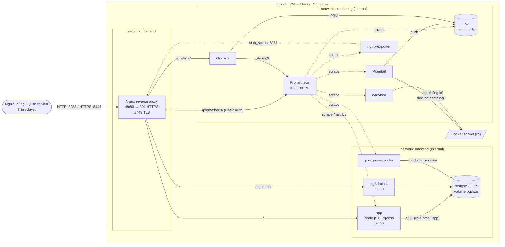
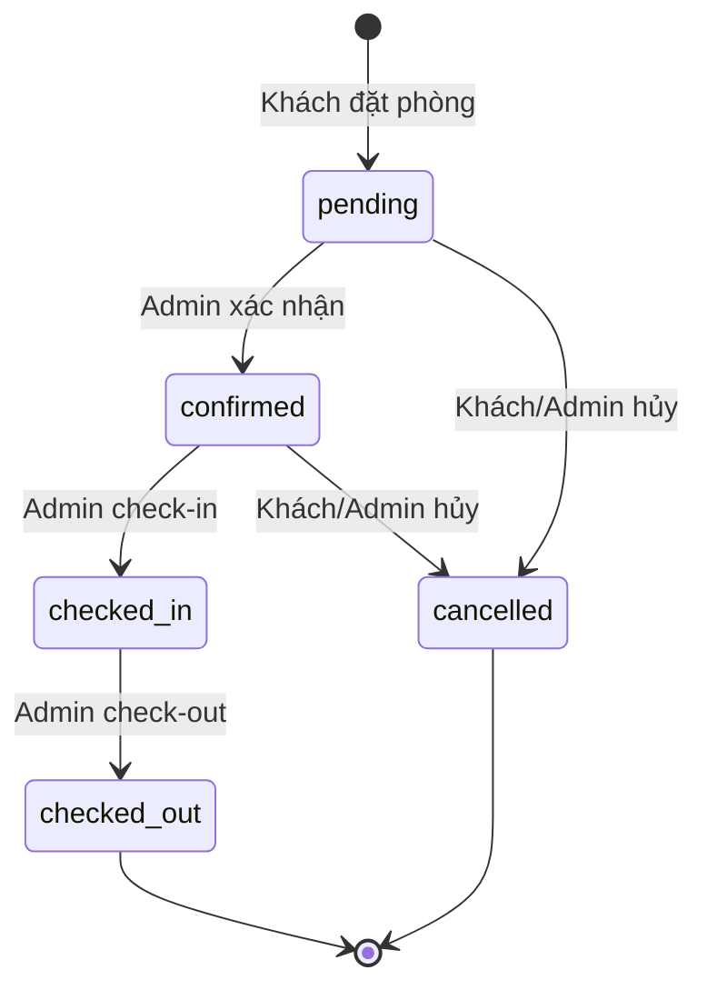

# Hotel Booking — Hệ thống đặt phòng khách sạn (Đề 6)

Bài thực hành môn **Triển khai và Quản trị Hệ thống Phần mềm**: website đặt phòng khách sạn
chạy hoàn toàn bằng **Docker Compose**. Hệ thống gồm Nginx reverse proxy (HTTPS tự ký), PostgreSQL, pgAdmin,
giám sát bằng Prometheus + Grafana, thu thập log bằng Loki + Promtail, và các biện pháp hardening container.

## Mục lục
1. [Kiến trúc hệ thống](#1-kiến-trúc-hệ-thống)
2. [Sơ đồ kiến trúc](#2-sơ-đồ-kiến-trúc)
3. [Yêu cầu môi trường & cài đặt](#3-yêu-cầu-môi-trường--cài-đặt)
4. [Cấu hình `.env`](#4-cấu-hình-env)
5. [Khởi chạy / dừng hệ thống](#5-khởi-chạy--dừng-hệ-thống)
6. [Địa chỉ truy cập](#6-địa-chỉ-truy-cập)
7. [Tài khoản demo & đổi mật khẩu](#7-tài-khoản-demo--đổi-mật-khẩu)
8. [Chức năng ứng dụng](#8-chức-năng-ứng-dụng)
9. [Kiểm tra database & dữ liệu mẫu](#9-kiểm-tra-database--dữ-liệu-mẫu)
10. [Kiểm tra Prometheus targets](#10-kiểm-tra-prometheus-targets)
11. [Dashboard Grafana](#11-dashboard-grafana)
12. [Truy vấn LogQL & xem log](#12-truy-vấn-logql--xem-log)
13. [HTTPS tự ký](#13-https-tự-ký)
14. [Các biện pháp hardening](#14-các-biện-pháp-hardening)
15. [Kiểm thử tự động](#15-kiểm-thử-tự-động)
16. [Xử lý lỗi thường gặp](#16-xử-lý-lỗi-thường-gặp)
17. [Danh sách ảnh chụp màn hình cho báo cáo](#17-danh-sách-ảnh-chụp-màn-hình-cho-báo-cáo)
18. [Cấu trúc thư mục](#18-cấu-trúc-thư-mục)

---

## 1. Kiến trúc hệ thống

| Service | Image | Vai trò | Network | Cổng ra host |
|---|---|---|---|---|
| `nginx` | `nginxinc/nginx-unprivileged:1.30.6-alpine` | Reverse proxy, TLS, security headers, rate limit — **điểm truy cập duy nhất** | frontend, backend, monitoring | **8088** (HTTP→HTTPS), **8443** (HTTPS) |
| `app` | build từ `app/` (Node.js 22 + Express) | Website + REST API đặt phòng, xuất `/metrics` | backend, monitoring | — |
| `db` | `postgres:15.19-alpine3.23` | Lưu dữ liệu lâu dài (volume `pgdata`) | backend | — |
| `pgadmin` | `dpage/pgadmin4:9.18` | Quản trị PostgreSQL qua web (`/pgadmin/`) | backend | — |
| `prometheus` | `prom/prometheus:v3.5.5` | Thu thập metrics, cảnh báo (`/prometheus/`) | monitoring | — |
| `grafana` | `grafana/grafana:12.4.13` | Dashboard metrics + log (`/grafana/`) | monitoring | — |
| `loki` | `grafana/loki:3.6.11` | Lưu trữ log | monitoring | — |
| `promtail` | `grafana/promtail:3.6.11` | Đọc log container qua Docker API → Loki | monitoring | — |
| `cadvisor` | `gcr.io/cadvisor/cadvisor:v0.52.1` | Metrics CPU/RAM/network của container | monitoring | — |
| `postgres-exporter` | `prometheuscommunity/postgres-exporter:v0.20.1` | Metrics PostgreSQL | backend, monitoring | — |
| `nginx-exporter` | `nginx/nginx-prometheus-exporter:1.5.3` | Metrics Nginx (stub_status) | monitoring | — |

**Network**
- `frontend` — network duy nhất có cổng publish ra host (chỉ Nginx).
- `backend` (`internal: true`) — app ↔ PostgreSQL ↔ pgAdmin; không có đường ra Internet.
- `monitoring` (`internal: true`) — Prometheus, Grafana, Loki, Promtail, exporters.

Các service gọi nhau **bằng tên service** (`db`, `app`, `loki`…) qua DNS nội bộ của Docker, không dùng IP cố định.

**Ứng dụng**: Node.js/Express phục vụ giao diện HTML/CSS/JS thuần (SPA nhỏ, không cần bước build) và REST API.
Ứng dụng kết nối PostgreSQL bằng role `hotel_app` có quyền hạn chế (không phải superuser).
Việc **chống đặt trùng phòng** được đảm bảo ở tầng database bằng ràng buộc
`EXCLUDE USING gist (room_id WITH =, daterange(check_in, check_out, '[)') WITH &&)`, nên vẫn đúng khi có nhiều request đồng thời.

## 2. Sơ đồ kiến trúc



## 3. Yêu cầu môi trường & cài đặt

**Đã kiểm thử trên**: Ubuntu 18.04 (VMware), Docker Engine 20.10.21, Docker Compose v2.24.7 (`docker-compose`), 2 vCPU, RAM 4 GB.

**Tối thiểu khuyến nghị**: 2 vCPU, **RAM 4 GB** (toàn bộ 11 container dùng khoảng **0,6 GB RAM** khi chạy; giới hạn
`mem_limit` cộng lại khoảng 3 GB), **ổ trống ≥ 5 GB** cho các image.

```bash
# 1. Cài Docker + Docker Compose (nếu chưa có)
sudo apt-get update
sudo apt-get install -y docker.io git openssl curl python3
sudo usermod -aG docker $USER      # đăng xuất / đăng nhập lại để có hiệu lực
# Docker Compose v2 (bản binary độc lập):
sudo curl -L "https://github.com/docker/compose/releases/download/v2.24.7/docker-compose-linux-x86_64" \
     -o /usr/local/bin/docker-compose && sudo chmod +x /usr/local/bin/docker-compose
docker --version && docker-compose version

# 2. Lấy mã nguồn
git clone https://github.com/dtc245010019-alt/hotel-booking.git
cd hotel-booking
```

> Nếu máy có plugin `docker compose` (có dấu cách) thì có thể dùng nó thay cho `docker-compose` trong mọi lệnh.

## 4. Cấu hình `.env`

Mọi cấu hình nhạy cảm (mật khẩu, khóa ký phiên) đều nằm trong file `.env`. File này **đã được Git ignore**,
còn trong repo chỉ có `.env.example` chứa giá trị minh họa `change_me...`.

**Cách nhanh (khuyến nghị)** — script tự sinh mật khẩu ngẫu nhiên mạnh, chứng chỉ HTTPS và file Basic Auth:

```bash
./scripts/setup.sh
```

Script này an toàn khi chạy lại: không ghi đè giá trị đã có trong `.env`, chỉ bổ sung các khóa còn thiếu.

**Cách thủ công**: `cp .env.example .env`, thay mọi giá trị `change_me...` (chỉ dùng ký tự `A-Z a-z 0-9 . _ -`),
rồi vẫn chạy `./scripts/setup.sh` để tạo chứng chỉ và `nginx/htpasswd`.

| Biến | Ý nghĩa |
|---|---|
| `PUBLIC_HOST` | Hostname/IP dùng để truy cập (dùng cho URL tuyệt đối của Grafana), ví dụ `192.168.71.131` |
| `DB_NAME`, `DB_USER`, `DB_PASSWORD` | Database và **superuser** PostgreSQL (dùng cho quản trị / pgAdmin) |
| `APP_DB_PASSWORD` | Mật khẩu role `hotel_app` mà ứng dụng sử dụng (quyền hạn chế) |
| `MONITOR_DB_PASSWORD` | Mật khẩu role `hotel_monitor` của postgres-exporter (chỉ có `pg_monitor`) |
| `ADMIN_USER`, `ADMIN_PASSWORD` | Tài khoản trang quản trị website (mật khẩu ≥ 12 ký tự) |
| `SESSION_SECRET` | Khóa HMAC ký cookie phiên quản trị (≥ 32 ký tự) |
| `PGADMIN_EMAIL`, `PGADMIN_PASSWORD` | Tài khoản pgAdmin (email phải hợp lệ, không dùng đuôi `.local`) |
| `GRAFANA_USER`, `GRAFANA_PASSWORD` | Tài khoản admin Grafana |
| `PROMETHEUS_USER`, `PROMETHEUS_PASSWORD` | Basic Auth cho Prometheus UI tại Nginx |

> ⚠️ `DB_*`, `APP_DB_PASSWORD`, `MONITOR_DB_PASSWORD`, `PGADMIN_*` và `GRAFANA_*` **chỉ được áp dụng khi volume còn trống**
> (lần chạy đầu tiên). Để đổi về sau, xem [mục 7](#7-tài-khoản-demo--đổi-mật-khẩu).

## 5. Khởi chạy / dừng hệ thống

```bash
./scripts/setup.sh                 # lần đầu: tạo .env, chứng chỉ, htpasswd
docker-compose up -d --build       # build app và chạy toàn bộ 11 service
docker-compose ps                  # xem trạng thái (đợi các service "healthy", khoảng 1 phút)
docker-compose logs -f app nginx   # xem log trực tiếp
```

| Thao tác | Lệnh |
|---|---|
| Dừng (giữ container) | `docker-compose stop` |
| Chạy lại | `docker-compose start` |
| Dừng và xóa container/network (**giữ dữ liệu**) | `docker-compose down` |
| Xóa **toàn bộ dữ liệu** (DB, dashboard, log…) — không thể khôi phục | `docker-compose down -v` |
| Build lại app sau khi sửa code | `docker-compose up -d --build app` |
| Chỉ chạy phần lõi (máy yếu, không monitoring) | `docker-compose up -d nginx app db pgadmin` |

> Khi chỉ chạy phần lõi, các đường dẫn `/grafana/`, `/prometheus/` sẽ trả về 502; website vẫn hoạt động bình thường.

## 6. Địa chỉ truy cập

Nginx có hai chế độ truy cập, dùng chung một bộ cấu hình location (`nginx/snippets/locations.conf`):

**a) HTTP trên localhost — dành cho phát triển/demo trên chính máy chạy Docker** (không cảnh báo chứng chỉ):

| Giao diện | URL | Đăng nhập |
|---|---|---|
| Website đặt phòng | http://localhost:8088/ | không cần |
| Trang quản trị website | http://localhost:8088/admin.html | `ADMIN_USER` / `ADMIN_PASSWORD` |
| pgAdmin | http://localhost:8088/pgadmin/ | `PGADMIN_EMAIL` / `PGADMIN_PASSWORD` |
| Grafana | http://localhost:8088/grafana/ | `GRAFANA_USER` / `GRAFANA_PASSWORD` |
| Prometheus | http://localhost:8088/prometheus/ | Basic Auth `PROMETHEUS_USER` / `PROMETHEUS_PASSWORD` |

`http://127.0.0.1:8088/…` cũng dùng được. Trên kết nối HTTP này, Nginx bỏ cờ `Secure` của cookie đăng nhập
(`proxy_cookie_flags ~ nosecure`) để đăng nhập hoạt động, và không gửi HSTS.

**b) HTTPS — dành cho truy cập từ máy khác** (thay `<IP_VM>` bằng IP của VM, xem bằng `hostname -I`):

| Giao diện | URL |
|---|---|
| Website / Quản trị | `https://<IP_VM>:8443/` · `https://<IP_VM>:8443/admin.html` |
| pgAdmin / Grafana / Prometheus | `https://<IP_VM>:8443/pgadmin/` · `/grafana/` · `/prometheus/` |
| HTTP bằng IP | `http://<IP_VM>:8088/…` → **tự chuyển sang** `https://<IP_VM>:8443/…` |

`https://localhost:8443/…` vẫn hoạt động (cảnh báo chứng chỉ tự ký, xem [mục 13](#13-https-tự-ký)).
Hai chế độ được Nginx phân biệt bằng header `Host`: `localhost`/`127.0.0.1` → phục vụ HTTP; mọi tên/IP khác → chuyển hướng HTTPS.

> Muốn dùng `http://localhost:8088` từ máy Windows bên ngoài VM, cần cấu hình port forwarding
> (VMware *NAT Settings → Port Forwarding* 8088 → `<IP_VM>:8088`) hoặc SSH tunnel: `ssh -L 8088:localhost:8088 dungvv@<IP_VM>`.

PostgreSQL, Loki, cAdvisor và các exporter **không** publish cổng ra ngoài, nên chỉ truy cập được bên trong Docker network.

## 7. Tài khoản demo & đổi mật khẩu

Repo **không chứa mật khẩu thật**. Mật khẩu được sinh ngẫu nhiên vào `.env` khi chạy `setup.sh`. Xem bằng lệnh:

```bash
grep -E '_USER=|_EMAIL=|_PASSWORD=' .env
```

**Đổi mật khẩu:**

| Tài khoản | Cách đổi |
|---|---|
| Admin website | Sửa `ADMIN_PASSWORD` trong `.env` → `docker-compose up -d app` |
| Prometheus Basic Auth | Sửa `PROMETHEUS_PASSWORD` → `./scripts/setup.sh` → `docker-compose restart nginx` |
| Grafana | Đổi trong UI (avatar → *Change password*) hoặc `docker-compose exec grafana grafana cli admin reset-admin-password '<mật-khẩu-mới>'`, sau đó cập nhật `.env` cho khớp |
| pgAdmin | Đổi trong UI (menu người dùng → *Change Password*); biến `.env` chỉ có tác dụng ở lần tạo đầu tiên |
| Role PostgreSQL `hotel_app` / `hotel_monitor` | Sửa `APP_DB_PASSWORD` / `MONITOR_DB_PASSWORD` trong `.env` → `docker-compose up -d db` → `./scripts/db-migrate.sh` (script chạy `ALTER ROLE` theo `.env`) → `docker-compose up -d app postgres-exporter` |
| Superuser `DB_USER` | `docker-compose exec db psql -U "$DB_USER" -d "$DB_NAME" -c "\password"` rồi cập nhật `DB_PASSWORD` trong `.env` |

## 8. Chức năng ứng dụng

**Khách hàng** (`https://<HOST>:8443/`)
- Tìm phòng theo **ngày nhận / ngày trả**, **số khách** và **loại phòng** (Standard, Deluxe, Suite, Family); kết quả chỉ gồm phòng còn trống, kèm tổng tiền theo số đêm.
- Trang **chi tiết phòng**: mô tả, sức chứa, giường, diện tích, tiện nghi, các khoảng ngày đã có người đặt.
- **Đặt phòng** (họ tên, email, SĐT, số khách, ghi chú) → nhận **mã đặt phòng** (ví dụ `HB3F9A1C2D`). Không có thanh toán thật.
- **Tra cứu / hủy đặt phòng** bằng mã + email (chỉ hủy được khi chưa đến ngày nhận phòng).

**Quy tắc kiểm tra dữ liệu** (kiểm tra ở cả API lẫn ràng buộc trong DB):
- Ngày đúng định dạng và là ngày có thật; **ngày trả phải sau ngày nhận**; không đặt cho ngày quá khứ; tối đa 30 đêm; đặt trước tối đa 365 ngày.
- Số khách không vượt sức chứa phòng; phòng đang bảo trì không nhận đặt.
- **Không đặt trùng**: khoảng `[check_in, check_out)` của các đặt phòng còn hiệu lực (`pending`, `confirmed`, `checked_in`) không được giao nhau. Ngày trả của khách trước có thể trùng ngày nhận của khách sau.

**Trạng thái đặt phòng**



**Quản trị** (`/admin.html`): thống kê (phòng có khách hôm nay, chờ xác nhận, khách đến/đi trong ngày, doanh thu dự kiến),
quản lý đặt phòng (lọc, tìm kiếm, chuyển trạng thái), quản lý phòng (thêm, sửa, chuyển bảo trì/ngừng sử dụng, xóa phòng chưa có lịch sử đặt).

**REST API chính**

| Method | Đường dẫn | Mô tả |
|---|---|---|
| GET | `/api/rooms?check_in&check_out&guests&type` | Tìm phòng (còn trống nếu có truyền ngày) |
| GET | `/api/rooms/:id` | Chi tiết phòng + lịch đã đặt |
| GET | `/api/room-types` | Danh sách loại phòng |
| POST | `/api/bookings` | Tạo đặt phòng (201 / 400 / 409 trùng lịch) |
| GET | `/api/bookings/lookup?code&email` | Tra cứu |
| POST | `/api/bookings/:code/cancel` | Khách hủy |
| POST | `/api/admin/login` · `/api/admin/logout` | Đăng nhập/đăng xuất quản trị |
| GET | `/api/admin/stats` · `/api/admin/bookings` · `/api/admin/rooms` | Dữ liệu quản trị (cần đăng nhập) |
| PATCH | `/api/admin/bookings/:id` | Đổi trạng thái đặt phòng |
| POST/PUT/DELETE | `/api/admin/rooms[/:id]` | Quản lý phòng |

## 9. Kiểm tra database & dữ liệu mẫu

Schema và dữ liệu mẫu nằm trong `db/init/` và **tự chạy khi volume `pgdata` còn trống**:
- `01-schema.sql` — bảng `rooms`, `bookings`, các ràng buộc CHECK/UNIQUE/EXCLUDE và index.
- `02-seed.sql` — 10 phòng (4 loại) và 6 đặt phòng mẫu (mã `HBDEMO01`…`HBDEMO06`, ngày tính tương đối theo ngày hiện tại, đủ các trạng thái).
- `03-roles.sh` — role `hotel_app` (SELECT/INSERT/UPDATE…, không có DDL) và `hotel_monitor` (`pg_monitor`).

Các script đều **idempotent**. Khi nâng cấp từ một volume cũ, chạy `./scripts/db-migrate.sh` (không xóa dữ liệu).

**Kiểm tra bằng dòng lệnh:**
```bash
source <(grep -E '^DB_(USER|NAME)=' .env)
docker-compose exec db psql -U "$DB_USER" -d "$DB_NAME" -c "\dt"
docker-compose exec db psql -U "$DB_USER" -d "$DB_NAME" -c "SELECT name, type, price, capacity, status FROM rooms ORDER BY name;"
docker-compose exec db psql -U "$DB_USER" -d "$DB_NAME" -c "SELECT booking_code, room_id, check_in, check_out, status FROM bookings ORDER BY check_in;"
# Xem ràng buộc chống đặt trùng
docker-compose exec db psql -U "$DB_USER" -d "$DB_NAME" -c "SELECT conname, pg_get_constraintdef(oid) FROM pg_constraint WHERE conname='bookings_no_overlap';"
```

**Kiểm tra bằng pgAdmin:**
1. Mở `https://<HOST>:8443/pgadmin/`, đăng nhập bằng `PGADMIN_EMAIL` / `PGADMIN_PASSWORD`.
2. Ở cây bên trái, server **"Hotel Booking DB"** đã được cấu hình sẵn (host `db`, user `hotel_admin`). Bấm vào và nhập mật khẩu `DB_PASSWORD`.
   - Nếu chưa có server (hoặc bạn đổi `DB_USER`): *Register → Server…* → tab *Connection*: Host `db`, Port `5432`, Maintenance DB `postgres`, Username = `DB_USER`, Password = `DB_PASSWORD`.
3. Mở *Databases → hotel → Schemas → public → Tables*, bấm chuột phải vào `bookings` → *View/Edit Data → All Rows*.

## 10. Kiểm tra Prometheus targets

- Giao diện: `https://<HOST>:8443/prometheus/targets` (Basic Auth). Phải có **7 target UP**:
  `prometheus`, `hotel-app`, `postgres`, `nginx`, `cadvisor`, `loki`, `promtail`.
- Cảnh báo: `https://<HOST>:8443/prometheus/alerts` (TargetDown, PostgresDown, HighHttp5xxRate, SlowRequests, ContainerHighMemory).
- Bằng dòng lệnh:
```bash
PA="$(grep ^PROMETHEUS_USER= .env|cut -d= -f2-):$(grep ^PROMETHEUS_PASSWORD= .env|cut -d= -f2-)"
curl -sk -u "$PA" https://localhost:8443/prometheus/api/v1/targets \
  | python3 -c "import sys,json;[print(t['labels']['job'],t['health']) for t in json.load(sys.stdin)['data']['activeTargets']]"
```
- Cấu hình: scrape mỗi **15s** (cAdvisor 30s), lưu **7 ngày / tối đa 1 GB** (`--storage.tsdb.retention.*`).
- Một số truy vấn PromQL để demo (trang *Query*):
  - `up`
  - `sum by (route) (rate(http_request_duration_seconds_count{job="hotel-app"}[1m]))`
  - `histogram_quantile(0.95, sum by (le) (rate(http_request_duration_seconds_bucket[5m])))`
  - `hotel_bookings` · `hotel_rooms_occupied` · `increase(hotel_booking_conflicts_total[1h])`
  - `pg_up` · `pg_stat_activity_count` · `nginx_connections_active`
  - `container_memory_working_set_bytes{name=~"hotel_.+"}`

## 11. Dashboard Grafana

1. Mở `https://<HOST>:8443/grafana/`, đăng nhập bằng `GRAFANA_USER` / `GRAFANA_PASSWORD`.
2. *Connections → Data sources*: có sẵn **Prometheus** (mặc định) và **Loki** (được provisioning, không sửa được trên UI).
3. *Dashboards → thư mục "Hotel Booking"*:
   - **Hotel Booking - Tổng quan**: trạng thái target, phòng có khách, đặt phòng chờ xác nhận, đặt mới / bị chặn trùng (24h), request/s theo route và mã HTTP, độ trễ p50/p95/p99, đặt phòng theo trạng thái, Nginx request/kết nối, PostgreSQL (kết nối, transactions/s, kích thước, cache hit, connection pool), CPU/RAM/network từng container.
   - **Hotel Booking - Logs**: số dòng log theo service, mã trạng thái từ access log, top URI lỗi, log theo level và các panel LogQL mẫu.

Dashboard được sinh bởi `scripts/gen-dashboards.py`. Muốn sửa thì sửa script, chạy `python3 scripts/gen-dashboards.py`; Grafana tự nạp lại sau tối đa 60 giây.

**Tạo traffic để dashboard có số liệu**: chạy `./scripts/smoke-test.sh` vài lần, hoặc thao tác trên website.

## 12. Truy vấn LogQL & xem log

Promtail đọc log stdout/stderr của mọi container trong project (lọc theo label `com.docker.compose.project=hotel-booking`) qua Docker API.

**Nhãn (label)** — chỉ dùng các nhãn có ít giá trị để tránh cardinality cao:

| Nhãn | Giá trị |
|---|---|
| `job` | `docker` |
| `project` | `hotel-booking` |
| `service` | `app`, `nginx`, `db`, `pgadmin`, `grafana`, … |
| `container` | `hotel_app`, `hotel_nginx`, … |
| `stream` | `stdout`, `stderr` |
| `level` | `info`, `warn`, `error`… (app, db, nginx error log) |
| `log_type` | `access`, `error` (chỉ Nginx) |

Các trường có nhiều giá trị (`status`, `uri`, `ip`, `booking_id`…) **không** được dùng làm nhãn; chúng được tách ra lúc truy vấn bằng `| json`.
Log được giữ 7 ngày. Access log Nginx và log ứng dụng đều ở dạng **JSON một dòng**.

**Cách xem:** Grafana → *Explore* → chọn datasource **Loki** → dán truy vấn → *Run query* (hoặc mở dashboard **Hotel Booking - Logs**).

| # | Mục đích | LogQL |
|---|---|---|
| a | Access log Nginx | `{service="nginx", stream="stdout"} \| json` |
| a' | Access log của API đặt phòng | `{service="nginx", log_type="access"} \| json \| uri =~ "/api/bookings.*"` |
| b | HTTP 4xx và 5xx | `{service="nginx", stream="stdout"} \| json \| status >= 400` |
| b' | Chỉ HTTP 5xx | `{service="nginx", stream="stdout"} \| json \| status >= 500` |
| c | Log lỗi/cảnh báo của ứng dụng | `{service="app"} \| json \| level=~"error\|warn"` |
| c' | Chỉ log lỗi của ứng dụng | `{service="app", level="error"}` |
| d | Đặt phòng bị chặn do trùng lịch | `{service="app"} \|= "booking conflict" \| json` |
| e | Đăng nhập quản trị (thành công/thất bại) | `{service="app"} \|~ "admin login" \| json` |
| f | Lỗi PostgreSQL | `{service="db", level="error"}` |
| g | Error log của Nginx | `{service="nginx", log_type="error"}` |
| m1 | Số request theo mã HTTP (5 phút) | `sum by (status) (count_over_time({service="nginx", stream="stdout"} \| json \| __error__="" [5m]))` |
| m2 | Top 10 URI lỗi trong 1 giờ | `topk(10, sum by (uri, status) (count_over_time({service="nginx", stream="stdout"} \| json \| status >= 400 [1h])))` |
| m3 | Số dòng log theo service | `sum by (service) (count_over_time({project="hotel-booking"}[5m]))` |

> Trong bảng Markdown ở trên, ký tự `|` được viết thành `\|`. Khi dán vào Grafana, hãy dùng `|` bình thường.

**Tạo log lỗi để demo truy vấn (c'):** dừng DB một lúc rồi bật lại (dữ liệu không mất):
```bash
docker-compose stop db; curl -sk https://localhost:8443/api/rooms; docker-compose start db
```

**Xem log bằng dòng lệnh:** `docker-compose logs -f --tail 50 nginx app`

## 13. HTTPS tự ký

### Tạo / tạo lại chứng chỉ
`./scripts/setup.sh` tạo chứng chỉ RSA 2048, hạn 365 ngày, có **SubjectAltName (SAN)** gồm:
`localhost`, `127.0.0.1`, hostname của máy, IPv4 của các card mạng thật (bỏ qua `docker0`, `br-*`, `veth*`),
`PUBLIC_HOST` và các giá trị thêm trong `EXTRA_SAN`.

```bash
# Tạo lại (ví dụ khi đổi IP VM hoặc thêm tên miền):
FORCE_CERT=1 ./scripts/setup.sh
FORCE_CERT=1 EXTRA_SAN="DNS:hotel.lab,IP:10.0.0.5" ./scripts/setup.sh   # thêm tên/IP khác
docker-compose exec nginx nginx -t && docker-compose exec nginx nginx -s reload   # áp dụng, không gián đoạn
```

Quy trình an toàn của script: (1) tạo cert/key trong thư mục tạm `nginx/certs/.staging.*` →
(2) kiểm tra cert đọc được, key khớp cert, có SAN, và `nginx -t` với cert mới →
(3) **sao lưu cặp cũ** vào `nginx/certs/backup-<YYYYmmdd-HHMMSS>/` (key quyền 600) → (4) mới thay thế.
Nếu bất kỳ bước kiểm tra nào lỗi, cert cũ được giữ nguyên. Script **không thay đổi** các giá trị đã có trong `.env`.
Cả thư mục `nginx/certs/` (kể cả bản sao lưu) đều đã được Git ignore.

Khôi phục cert cũ: `cp -p nginx/certs/backup-<thời-gian>/server.* nginx/certs/ && chmod 644 nginx/certs/server.key && docker-compose exec nginx nginx -s reload`.

Xem SAN của cert: `openssl x509 -in nginx/certs/server.crt -noout -ext subjectAltName`

**Cấu hình Nginx** (`nginx/default.conf`): chỉ cho phép TLS 1.2/1.3, HTTP/2, `ssl_session_tickets off`;
cổng 8080 (host 8088): `Host` là `localhost`/`127.0.0.1` thì phục vụ HTTP trực tiếp, Host khác thì chuyển hướng 301 sang `https://…:8443`;
request HTTP gửi nhầm vào cổng 8443 cũng được chuyển hướng (`error_page 497`).
HSTS (`max-age=31536000`) chỉ được gửi qua HTTPS và **không gửi cho `localhost`/`127.0.0.1`**: HSTS áp dụng theo hostname cho mọi cổng,
nếu gửi cho `localhost` thì trình duyệt sẽ tự nâng `http://localhost:8088` lên HTTPS và không mở được.

### Phân biệt các loại lỗi khi kiểm tra bằng curl

| Lệnh | Kết quả mong đợi | Ý nghĩa |
|---|---|---|
| `curl https://<IP>:8444/` | `exit 7 Connection refused` | **Lỗi kết nối**: sai cổng / dịch vụ không chạy / firewall |
| `curl https://<IP>:8443/` | `exit 60 self signed certificate` | **Lỗi tin cậy**: cert tự ký không do CA tin cậy ký — *luôn xảy ra* với cert tự ký |
| `curl --cacert nginx/certs/server.crt --resolve sai.ten:8443:127.0.0.1 https://sai.ten:8443/` | `exit 51 no alternative certificate subject name matches` | **Lỗi hostname/SAN**: đã tin cert nhưng tên truy cập không có trong SAN → tạo lại cert với `EXTRA_SAN` |
| `curl --cacert nginx/certs/server.crt https://<IP>:8443/` | `200` | Thành công: tin cậy cert + tên khớp SAN |
| `curl -k https://<IP>:8443/` | `200` | Bỏ qua kiểm tra cert (chỉ dùng để test) |

### Cảnh báo trình duyệt (môi trường demo)
Chứng chỉ tự ký **không được trình duyệt tin cậy mặc định**. Lần đầu truy cập, trình duyệt sẽ báo
"Your connection is not private" / `NET::ERR_CERT_AUTHORITY_INVALID` (Firefox: `SEC_ERROR_UNKNOWN_ISSUER`).
Kết nối **vẫn được mã hóa**, nhưng trình duyệt không xác minh được danh tính máy chủ. Có hai cách xử lý phù hợp cho demo:

1. **Chấp nhận ngoại lệ (đơn giản nhất)**: *Advanced → Proceed to 192.168.71.131 (unsafe)* (Firefox: *Advanced → Accept the Risk and Continue*).
   Thanh địa chỉ vẫn hiển thị "Not secure". Đây là trạng thái đúng của cert tự ký.
2. **Tin cậy cert trên máy client** (để không còn cảnh báo, chỉ làm trên máy demo của bạn):
   - Lấy file cert: `scp dungvv@192.168.71.131:~/hotel-booking/nginx/certs/server.crt hotel-demo.crt`
   - Windows (Chrome/Edge): nháy đúp file → *Install Certificate* → *Current User* → *Place all certificates in the following store* → **Trusted Root Certification Authorities** → khởi động lại trình duyệt.
   - Firefox: *Settings → Privacy & Security → Certificates → View Certificates → Authorities → Import*.
   - Chỉ cần làm với **cert trên máy demo của bạn**; gỡ cert sau khi demo xong. Mỗi lần tạo lại cert phải import lại.
   - Lưu ý HSTS: trình duyệt bỏ qua header HSTS khi cert không tin cậy (cách 1). Nhưng nếu đã tin cậy cert (cách 2),
     trình duyệt sẽ ghi nhớ HSTS trong 1 năm cho địa chỉ đó; khi đó nếu đổi cert mà chưa import lại thì **không thể bấm bỏ qua cảnh báo**.
     Cách xử lý: import cert mới, hoặc xóa HSTS tại `chrome://net-internals/#hsts` (*Delete domain security policies*).

Môi trường thật cần dùng chứng chỉ do CA công khai cấp (ví dụ Let's Encrypt) cho một tên miền thật.

## 14. Các biện pháp hardening

| Biện pháp | Áp dụng |
|---|---|
| Container chạy **non-root** | app (`node`, uid 1000), db (uid 70), nginx (uid 101), pgadmin (5050), grafana (472), prometheus/postgres-exporter (65534), loki (10001), nginx-exporter (1001). Promtail và cAdvisor chạy root vì cần đọc Docker socket và `/sys`, nhưng đã bỏ toàn bộ capability |
| `cap_drop: [ALL]` | **Tất cả** container (không container nào cần capability: dùng cổng > 1024, không chown) |
| `no-new-privileges:true` | Tất cả container |
| `read_only: true` + `tmpfs` | Tất cả trừ pgAdmin (entrypoint của pgAdmin phải ghi file cấu hình khi khởi động) |
| Tách network | `backend` và `monitoring` là `internal: true`; chỉ Nginx nằm ở `frontend` |
| Không publish cổng nội bộ | Chỉ 8088/8443; PostgreSQL, pgAdmin, Grafana, Prometheus, Loki, exporters **không** có cổng ra host |
| Least privilege trong DB | App dùng role `hotel_app` (không phải superuser, không có DDL, không DELETE bookings); exporter dùng `hotel_monitor` (`pg_monitor`); `REVOKE CREATE ON SCHEMA public FROM PUBLIC` |
| Secret | Lấy từ `.env` (Git ignore, `chmod 600`), `.env.example` chỉ chứa giá trị minh họa; `setup.sh` sinh mật khẩu ngẫu nhiên |
| Security headers (Nginx) | HSTS, CSP chặt (`script-src 'self'`, không inline script), `X-Content-Type-Options`, `X-Frame-Options`, `Referrer-Policy`, `Permissions-Policy`, COOP; `server_tokens off`; ẩn `X-Powered-By` |
| Giới hạn request | `client_max_body_size 2m` (pgAdmin 50m), body JSON của app ≤ 20 KB, timeout header/body 15s, proxy timeout; rate limit API 20 r/s/IP, đăng nhập 10 r/phút/IP |
| Endpoint nội bộ bị chặn | `/metrics`, `/healthz` trả 404 từ bên ngoài; `stub_status` chỉ cho dải IP private trên cổng 8081 không publish |
| Trang quản trị | Admin website: cookie `HttpOnly; Secure; SameSite=Strict` ký HMAC, khóa IP sau 5 lần sai/15 phút, kiểm tra Origin; Grafana: tắt đăng ký và anonymous; Prometheus: Basic Auth; pgAdmin: đăng nhập + enhanced cookie protection |
| Ứng dụng | Truy vấn có tham số (chống SQL injection), escape HTML (chống XSS), validate đầu vào, không lộ stack trace; danh sách đặt phòng không công khai |
| Image | Ghim phiên bản cụ thể (không dùng `latest`); app dùng `npm ci` theo `package-lock.json`, chỉ cài dependency production |
| Tài nguyên | `mem_limit`/`cpus` cho từng service; log driver `json-file` giới hạn 10 MB × 3 file |
| Healthcheck & restart | Healthcheck cho db, app, nginx, pgadmin, prometheus, grafana, cadvisor; `restart: unless-stopped` |

**Lưu ý:** Promtail và cAdvisor mount Docker socket ở chế độ `:ro`. Tuy vậy, quyền truy cập Docker API vẫn rất mạnh,
nên hai container này chỉ nằm trong network `internal` và không publish cổng.

## 15. Kiểm thử tự động

```bash
./scripts/smoke-test.sh                          # 46 kiểm thử end-to-end qua Nginx (mặc định https://localhost:8443)
BASE=http://localhost:8088 ./scripts/smoke-test.sh
BASE=https://192.168.71.131:8443 ./scripts/smoke-test.sh
```
Bộ kiểm thử bao gồm: trang web, tìm phòng, validate ngày (ngày trả ≤ ngày nhận, quá khứ, sai định dạng), đặt phòng,
đặt trùng (409), **20 request đặt phòng đồng thời → đúng 1 thành công**, tra cứu/hủy, phân quyền admin, cookie bảo mật,
chuyển trạng thái hợp lệ/không hợp lệ, CRUD phòng, chặn cross-origin, chặn `/metrics`.
Mỗi lần chạy dùng khoảng ngày ngẫu nhiên ở tương lai và hủy các đặt phòng test khi kết thúc.

## 16. Xử lý lỗi thường gặp

| Hiện tượng | Nguyên nhân / Cách xử lý |
|---|---|
| `docker: 'compose' is not a docker command` | Dùng `docker-compose` (bản binary) như trong README |
| `permission denied ... docker.sock` | `sudo usermod -aG docker $USER` rồi đăng xuất/đăng nhập lại |
| `Bind for 0.0.0.0:8443 failed: port is already allocated` | Có tiến trình khác dùng cổng: `sudo ss -ltnp \| grep -E '8088\|8443'`; dừng tiến trình đó hoặc đổi cổng bên trái trong `ports:` (nếu đổi 8443 thì sửa cả `return 301 https://$host:8443` trong `nginx/default.conf`) |
| Nginx restart liên tục, log `cannot load certificate` | Chưa có chứng chỉ: chạy `./scripts/setup.sh` |
| Nginx: `open() "/etc/nginx/htpasswd" failed` hoặc mount lỗi "not a directory" | Chưa có `nginx/htpasswd`: chạy `./scripts/setup.sh`. Nếu Docker đã tự tạo **thư mục** cùng tên thì xóa thư mục rỗng đó trước (`rmdir nginx/htpasswd`) |
| App thoát ngay, log `ADMIN_PASSWORD phải có ít nhất 12 ký tự` | Kiểm tra `ADMIN_PASSWORD`, `SESSION_SECRET` trong `.env` |
| App `unhealthy`, API trả 500 | DB chưa sẵn sàng: `docker-compose ps db`, `docker-compose logs db` |
| `password authentication failed for user "hotel_app"` | Đã đổi `APP_DB_PASSWORD` sau lần chạy đầu → chạy `./scripts/db-migrate.sh` để cập nhật role |
| Sửa `db/init/*.sql` nhưng không có tác dụng | Init script chỉ chạy khi volume trống → `./scripts/db-migrate.sh` (giữ dữ liệu) hoặc `docker-compose down -v` (**xóa toàn bộ dữ liệu**) |
| Đăng nhập Grafana/pgAdmin báo sai mật khẩu dù đã sửa `.env` | Mật khẩu chỉ được áp dụng ở lần tạo volume đầu tiên → xem [mục 7](#7-tài-khoản-demo--đổi-mật-khẩu) |
| pgAdmin báo `email address is not valid` | Dùng email có tên miền thường (ví dụ `admin@example.com`), không dùng `.local` |
| `/grafana/` hoặc `/prometheus/` trả 502 | Service chưa chạy hoặc đang khởi động: `docker-compose ps`, `docker-compose up -d grafana prometheus` |
| `/prometheus/` hỏi mật khẩu liên tục | Sai `PROMETHEUS_USER/PASSWORD`; sau khi đổi phải chạy lại `setup.sh` và `docker-compose restart nginx` |
| Grafana không có log (Loki trống) | `docker-compose logs promtail` (lỗi Docker socket?); target `promtail`/`loki` trong Prometheus phải UP |
| Target `cadvisor` DOWN hoặc không có metrics container | Kiểm tra mount `/var/lib/docker`, `/sys`; xem `docker-compose logs cadvisor` |
| Trình duyệt báo `ERR_CERT_COMMON_NAME_INVALID` / curl `exit 51` | Cert không có IP/hostname đang dùng trong SAN → `FORCE_CERT=1 [EXTRA_SAN=…] ./scripts/setup.sh` rồi `docker-compose exec nginx nginx -s reload` (xem mục 13) |
| Trình duyệt báo `ERR_CERT_AUTHORITY_INVALID`, không có nút *Proceed* | Địa chỉ đã bị ghi nhớ HSTS sau khi từng tin cậy cert cũ → import cert mới hoặc xóa HSTS tại `chrome://net-internals/#hsts` |
| Bị khóa đăng nhập admin (429) | Nginx giới hạn 10 lần/phút cho `/api/admin/login` (đợi khoảng 1 phút); app khóa IP sau 5 lần sai (đợi 15 phút hoặc `docker-compose restart app`) |
| `http://localhost:8088` bị chuyển sang `https://…:8443` hoặc sang IP cũ | Trình duyệt đã **cache redirect 301** hoặc **HSTS** từ cấu hình trước: mở cửa sổ ẩn danh, hoặc xóa cache (Ctrl+Shift+Del → *Cached images and files*) và xóa HSTS của `localhost` tại `chrome://net-internals/#hsts` (*Delete domain security policies*). Kiểm tra phía server: `curl -I http://localhost:8088/` phải trả `200` |
| Đăng nhập trên `http://localhost:8088` thành công nhưng bị đẩy lại trang đăng nhập | Phải truy cập đúng bằng `localhost`/`127.0.0.1` (Host khác sẽ bị chuyển sang HTTPS); kiểm tra `nginx/default.conf` còn dòng `proxy_cookie_flags ~ nosecure` trong server localhost |
| Hết RAM / VM chậm | Xem `docker stats`; chạy phần lõi `docker-compose up -d nginx app db pgadmin`; tăng RAM VM lên ≥ 4 GB |
| Hết dung lượng đĩa | `docker system df`; xóa image không dùng: `docker image prune` (cẩn thận với image của bài khác) |

## 17. Danh sách ảnh chụp màn hình cho báo cáo

1. `docker-compose ps`: 11 container `Up`/`healthy`.
2. `docker network ls` + `docker volume ls` (network/volume có tên rõ ràng); `docker network inspect hotel-booking_backend` có `"Internal": true`.
3. Trang chủ website, form tìm phòng và kết quả khi lọc theo ngày + số khách.
4. Trang chi tiết phòng (thông tin, tiện nghi, lịch đã đặt).
5. Đặt phòng thành công và hiển thị mã đặt phòng.
6. Lỗi validate: ngày trả trước ngày nhận; đặt trùng lịch (thông báo "Phòng đã có người đặt…").
7. Kết quả `./scripts/smoke-test.sh`, đặc biệt mục **20 request đồng thời → 1 thành công / 19 bị từ chối**.
8. Tra cứu và hủy đặt phòng.
9. Trang quản trị: đăng nhập, Tổng quan, Đặt phòng (xác nhận / check-in / check-out), Phòng (thêm/sửa/bảo trì).
10. Gọi `/api/admin/bookings` khi chưa đăng nhập → 401.
11. pgAdmin: đăng nhập qua `/pgadmin/`, server "Hotel Booking DB", dữ liệu bảng `rooms`/`bookings`, ràng buộc `bookings_no_overlap`.
12. `psql` từ dòng lệnh (mục 9).
13. Chứng chỉ HTTPS trong trình duyệt (cảnh báo tự ký + thông tin chứng chỉ) và `curl -vk` cho thấy TLSv1.3.
14. `curl -I http://<HOST>:8088` → 301 sang HTTPS; `curl -skI https://<HOST>:8443` thấy các security headers.
15. `/metrics` → 404 từ bên ngoài; `/prometheus/` → 401 khi không có mật khẩu.
16. Prometheus **Status → Targets**: 7 target UP; trang **Alerts**.
17. Prometheus trang Query với một biểu thức (ví dụ `hotel_bookings`).
18. Grafana **Data sources** (Prometheus, Loki).
19. Dashboard **Hotel Booking - Tổng quan** (toàn trang + phần PostgreSQL + phần Container).
20. Dashboard **Hotel Booking - Logs**.
21. Grafana **Explore** với Loki: truy vấn (a), (b), (c) — kèm kết quả.
22. Demo dừng DB: app trả 500, log `level="error"` trong Loki, rồi tự phục hồi sau khi DB chạy lại.
23. Hardening: `docker inspect` cho thấy `User`, `ReadonlyRootfs: true`, `CapDrop: [ALL]`, `no-new-privileges`; `docker-compose exec app touch /usr/x` → `Read-only file system`; `docker-compose exec app id`.
24. `docker port hotel_nginx` (chỉ 8088/8443) và `ss -ltn` trên host.
25. `git log` và `.gitignore` (không commit `.env`, chứng chỉ).
26. `docker stats --no-stream`: tài nguyên sử dụng.

## 18. Cấu trúc thư mục

```
hotel-booking/
├── app/                        # Ứng dụng Node.js/Express
│   ├── Dockerfile              # node:22 alpine, npm ci, USER node, HEALTHCHECK
│   ├── package.json, package-lock.json
│   ├── server.js               # Khởi tạo Express, access log, xử lý lỗi, /metrics, /healthz
│   ├── src/                    # db, auth (phiên admin), metrics, validate, routes/{public,admin}.js
│   └── public/                 # index.html, admin.html, css/, js/ (giao diện)
├── db/init/                    # 01-schema.sql, 02-seed.sql, 03-roles.sh (idempotent)
├── nginx/
│   ├── default.conf            # Reverse proxy, TLS, headers, rate limit, log JSON
│   ├── snippets/               # locations.conf (dùng chung HTTP/HTTPS), proxy.conf, security-headers.conf
│   ├── certs/                  # (Git ignore) chứng chỉ tự ký
│   └── htpasswd                # (Git ignore) Basic Auth Prometheus
├── pgadmin/servers.json        # Server PostgreSQL cấu hình sẵn cho pgAdmin
├── prometheus/                 # prometheus.yml, rules.yml
├── grafana/
│   ├── provisioning/           # datasources (Prometheus, Loki), dashboards provider
│   └── dashboards/             # hotel-overview.json, hotel-logs.json
├── loki/loki.yml
├── promtail/promtail.yml
├── scripts/
│   ├── setup.sh                # Sinh .env, chứng chỉ, htpasswd
│   ├── db-migrate.sh           # Áp dụng schema/seed/role lên DB đang chạy
│   ├── smoke-test.sh           # Kiểm thử end-to-end
│   └── gen-dashboards.py       # Sinh dashboard Grafana
├── docker-compose.yml
├── .env.example
└── .gitignore
```
